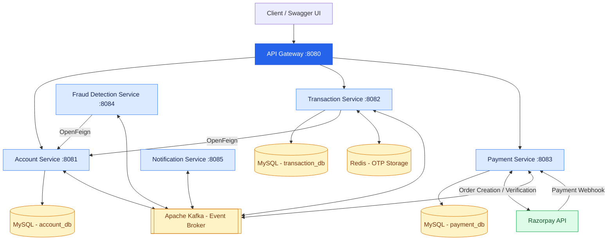
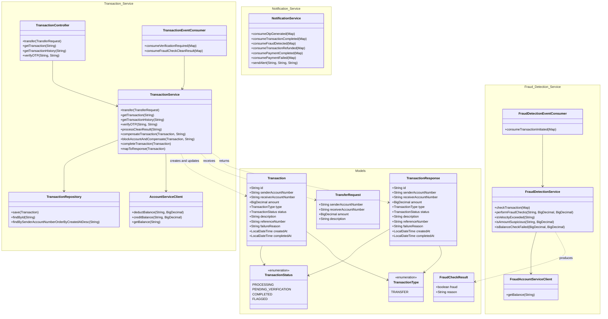
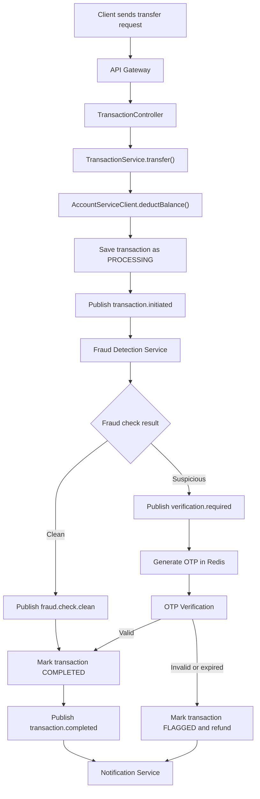
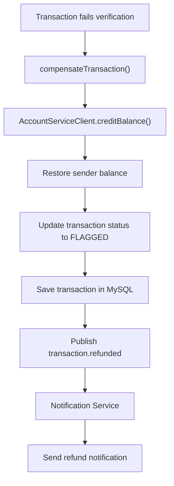
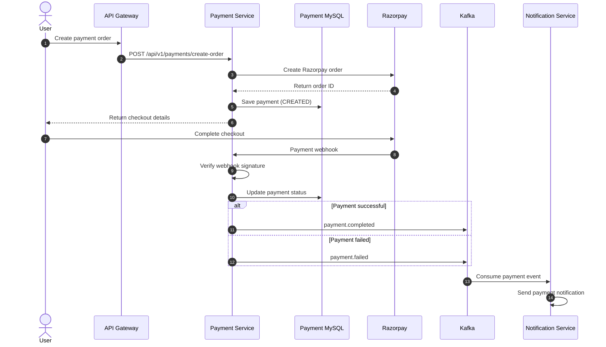
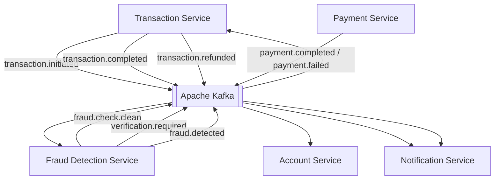

# Banking System – Microservices Architecture

A distributed banking platform built using **Java 17, Spring Boot, Spring Cloud, Apache Kafka, MySQL, Redis, and Razorpay**.

The system supports account management, money transfers, OTP verification, fraud detection, refunds, payment order creation, webhook processing, and notifications.

The application follows a **Microservices Architecture** with synchronous REST communication and asynchronous event-driven communication using Apache Kafka.

---

## Table of Contents

1. [Project Overview](#1-project-overview)
2. [System Architecture](#2-system-architecture)
3. [Technology Stack](#3-technology-stack)
4. [Microservices and Responsibilities](#4-microservices-and-responsibilities)
5. [Class-Level Architecture](#5-class-level-architecture)
6. [Transaction Processing Flow](#6-transaction-processing-flow)
7. [Fraud Detection and OTP Verification](#7-fraud-detection-and-otp-verification)
8. [Saga Compensation](#8-saga-compensation)
9. [Razorpay Payment Integration](#9-razorpay-payment-integration)
10. [Kafka Event Architecture](#10-kafka-event-architecture)
11. [Database and Redis Design](#11-database-and-redis-design)
12. [API Endpoints](#12-api-endpoints)
13. [Swagger Documentation](#13-swagger-documentation)
14. [Local Infrastructure](#14-local-infrastructure)
15. [Running the Project](#15-running-the-project)
16. [Environment Variables](#16-environment-variables)
17. [Implementation Challenges](#17-implementation-challenges)
18. [Future Improvements](#18-future-improvements)

---

## 1. Project Overview

The Banking System is a distributed application consisting of five independent Spring Boot microservices.

Each microservice handles a specific business responsibility:

- Account management and balance operations.
- Transaction processing and lifecycle management.
- Payment processing through Razorpay.
- Fraud detection and risk evaluation.
- Notifications for transactions, OTPs, refunds, and payments.

The services communicate through:

- **REST APIs:** Synchronous communication between services.
- **OpenFeign:** Declarative REST clients for inter-service communication.
- **Apache Kafka:** Asynchronous event-driven communication.
- **Redis:** Temporary OTP storage and expiration.
- **MySQL:** Persistent storage for account, transaction, and payment records.

---

## 2. System Architecture

### High-Level Architecture



### Communication Architecture

| Communication | Purpose |
|---|---|
| REST | Client requests through API Gateway |
| Spring Cloud OpenFeign | Transaction/Fraud services communicate with Account Service |
| Apache Kafka | Asynchronous event communication between microservices |
| Redis | OTP storage and automatic expiration |
| MySQL | Persistent application data |
| Razorpay API | External payment processing |

### Service Ports

| Microservice | Port |
|---|---:|
| API Gateway | 8080 |
| Account Service | 8081 |
| Transaction Service | 8082 |
| Payment Service | 8083 |
| Fraud Detection Service | 8084 |
| Notification Service | 8085 |

---

## 3. Technology Stack

| Technology | Purpose |
|---|---|
| Java 17 | Backend programming language |
| Spring Boot | Microservice development |
| Spring Cloud Gateway WebFlux | API Gateway and routing |
| Spring Cloud OpenFeign | Inter-service REST communication |
| Spring Data JPA | Database persistence |
| Hibernate | ORM |
| Apache Kafka | Event-driven communication |
| Redis | OTP storage and caching |
| MySQL | Relational database |
| Razorpay Java SDK | Payment gateway integration |
| Springdoc OpenAPI | API documentation |
| Swagger UI | API testing |
| Maven | Build and dependency management |
| Docker Compose | Local infrastructure |
| Lombok | Boilerplate code reduction |

---

## 4. Microservices and Responsibilities

### 4.1 Account Service

**Port:** 8081

Responsible for managing customer accounts and their balances.

**Responsibilities:**

- Create accounts.
- Retrieve account details.
- Get account balances.
- Deduct sender balances.
- Credit receiver balances.
- Process compensating refunds.
- Block compromised accounts.
- Consume fraud and compensation events.

**Main Endpoints:**

| Method | Endpoint | Description |
|---|---|---|
| POST | `/api/v1/accounts` | Create account |
| GET | `/api/v1/accounts/{accountNumber}` | Get account details |
| GET | `/api/v1/accounts/{accountNumber}/balance` | Get account balance |
| PUT | `/api/v1/accounts/{accountNumber}/block` | Block account |
| PUT | `/api/v1/accounts/{accountNumber}/deduct` | Deduct balance |
| PUT | `/api/v1/accounts/{accountNumber}/credit` | Credit balance |

The `deductBalance()` operation rejects inactive accounts.

The `creditBalance()` operation is used for receiver credits and compensating refunds.

### 4.2 Transaction Service

**Port:** 8082

Responsible for managing internal money transfers and their complete lifecycle.

**Responsibilities:**

- Initiate transfers.
- Persist transaction records.
- Deduct sender balances.
- Publish transaction events.
- Generate OTP values.
- Validate submitted OTP values.
- Complete successful transactions.
- Refund failed or suspicious transfers.
- Publish fraud, refund, and completion events.
- Maintain transaction history.

**Main Endpoints:**

| Method | Endpoint | Description |
|---|---|---|
| POST | `/api/v1/transactions/transfer` | Initiate transfer |
| GET | `/api/v1/transactions/{transactionId}` | Get transaction |
| GET | `/api/v1/transactions/account/{accountNumber}` | Get account transaction history |
| POST | `/api/v1/transactions/{transactionId}/verify?otp={otp}` | Verify OTP |

### 4.3 Payment Service

**Port:** 8083

Responsible for integrating Razorpay and processing external payments.

**Responsibilities:**

- Create Razorpay payment orders.
- Convert application amounts into Razorpay subunits.
- Store payment records in MySQL.
- Return Razorpay checkout information.
- Receive Razorpay webhook events.
- Update payment status to COMPLETED or FAILED.
- Publish payment events to Kafka.
- Trigger payment notifications.

**Main Endpoints:**

| Method | Endpoint | Description |
|---|---|---|
| POST | `/api/v1/payments/create-order` | Create Razorpay order |
| POST | `/api/v1/payments/webhook` | Receive Razorpay webhook |

### 4.4 Fraud Detection Service

**Port:** 8084

Consumes transaction initiation events and evaluates whether a transaction is suspicious.

**Fraud Detection Checks:**

1. Transaction velocity – Detects unusually frequent transactions.
2. Amount anomaly – Identifies unusually large transaction amounts.
3. Balance risk – Evaluates transaction amount against available balance.
4. Suspicious activity thresholds – Evaluates configured risk conditions.

**Fraud Outcomes:**

- Clean transaction: Publishes `fraud.check.clean`.
- Suspicious transaction: Publishes `verification.required`.
- Confirmed fraud: Publishes `fraud.detected`.

The Account Service consumes the fraud event and blocks the sender account.

### 4.5 Notification Service

**Port:** 8085

Consumes Kafka events and handles notification-related operations.

**Responsibilities:**

- OTP notifications.
- Transaction completion notifications.
- Refund notifications.
- Fraud detection notifications.
- Payment completion notifications.
- Payment failure notifications.

Notification delivery can later be integrated with email, SMS, WebSocket, push notifications, or an external provider.

---

## 5. Class-Level Architecture

This section describes the main classes and their responsibilities inside the microservices.

### 5.1 Transaction Service Classes

**TransactionController**

Handles incoming HTTP requests.

- `transfer(request)`
- `getTransaction(id)`
- `getTransactionHistory(accountNumber)`
- `verifyOTP(transactionId, otp)`

**TransactionService**

Contains the core transaction business logic.

- `transfer(TransferRequest request)`
- `getTransaction(String transactionId)`
- `getTransactionHistory(String accountNumber)`
- `verifyOTP(String transactionId, String otp)`
- `processCleanResult(String transactionId)`
- `compensateTransaction(Transaction transaction, String reason)`
- `blockAccountAndCompensate(Transaction transaction, String reason)`
- `completeTransaction(Transaction transaction)`
- `mapToResponse(Transaction transaction)`

**TransactionEventConsumer**

Consumes transaction-related Kafka events.

- `consumeVerificationRequired(Map payload)`
- `consumeFraudCheckCleanResult(Map payload)`

**TransactionRepository**

Handles transaction persistence.

- `save(Transaction transaction)`
- `findById(String id)`
- `findBySenderAccountNumberOrderByCreatedAtDesc(String accountNumber)`

**AccountServiceClient**

Communicates with Account Service using OpenFeign.

- `deductBalance(String accountNumber, BigDecimal amount)`
- `creditBalance(String accountNumber, BigDecimal amount)`
- `getBalance(String accountNumber)`

### 5.2 Fraud Detection Service Classes

**FraudDetectionEventConsumer**

- `consumeTransactionInitiated(Map payload)`

**FraudDetectionService**

- `checkTransaction(Map payload)`
- `performFraudChecks(String accountNumber, BigDecimal amount, BigDecimal balance)`
- `isVelocityExceeded(String accountNumber)`
- `isAmountSuspicious(String accountNumber, BigDecimal amount)`
- `isBalanceCheckFailed(BigDecimal balance, BigDecimal amount)`

**AccountServiceClient**

- `getBalance(String accountNumber)`

### 5.3 Notification Service Classes

**NotificationService**

- `consumeOtpGenerated(Map payload)`
- `consumeTransactionCompleted(Map payload)`
- `consumeFraudDetected(Map payload)`
- `consumeTransactionRefunded(Map payload)`
- `consumePaymentCompleted(Map payload)`
- `consumePaymentFailed(Map payload)`
- `sendAlert(String accountNumber, String subject, String message)`

### 5.4 Entity and Model Classes

**Transaction**

| Attribute | Description |
|---|---|
| id | Transaction identifier |
| senderAccountNumber | Sender account number |
| receiverAccountNumber | Receiver account number |
| amount | Transaction amount |
| type | Transaction type |
| status | Current transaction status |
| description | Transaction description |
| referenceNumber | Transaction reference |
| failureReason | Failure or compensation reason |
| createdAt | Creation timestamp |
| completedAt | Completion timestamp |

**TransferRequest**

- senderAccountNumber
- receiverAccountNumber
- amount
- description

**TransactionResponse**

Contains the transaction information returned to the client:

- id
- senderAccountNumber
- receiverAccountNumber
- amount
- type
- status
- description
- referenceNumber
- failureReason
- createdAt
- completedAt

**FraudCheckResult**

- fraud
- reason

### 5.5 Enums

**TransactionStatus**

- PROCESSING
- PENDING_VERIFICATION
- COMPLETED
- FLAGGED

**TransactionType**

- TRANSFER

### UML Class Diagram



### Class Responsibilities and Relationships

| Relationship | Responsibility |
|---|---|
| Controller → Service | Delegates business logic |
| Service → Repository | Database operations |
| Service → AccountServiceClient | Account operations through REST |
| EventConsumer → Service | Processes Kafka events |
| Service → Redis | OTP storage and retrieval |
| FraudDetectionService → FraudCheckResult | Fraud evaluation result |
| Transaction → TransactionStatus | Maintains transaction lifecycle |
| Transaction → TransactionType | Identifies transaction category |

---

## 6. Transaction Processing Flow

### 6.1 Standard Transfer Flow

The transaction lifecycle begins when the client sends a transfer request.

**API:**

`POST /api/v1/transactions/transfer`

**Execution Steps:**

1. Client sends transfer request through API Gateway.
2. Transaction Controller receives the request.
3. Transaction Service calls Account Service to deduct sender balance.
4. A Transaction entity is created.
5. Transaction status is set to `PROCESSING`.
6. Transaction is saved in MySQL.
7. `transaction.initiated` is published to Kafka.
8. Fraud Detection Service consumes the event.
9. Fraud checks are performed.
10. Depending on the result, the transaction is either completed or sent for OTP verification.

### Standard Transaction Flow Diagram



### 6.2 Clean Transaction Flow

When the transaction passes fraud detection:

1. Fraud Detection Service publishes `fraud.check.clean`.
2. Transaction Event Consumer receives the event.
3. `processCleanResult(transactionId)` is called.
4. Transaction status changes to `COMPLETED`.
5. Transaction is saved in MySQL.
6. `transaction.completed` is published.
7. Notification Service consumes the event.
8. Completion notification is generated.

### 6.3 Suspicious Transaction Flow

When a transaction is suspicious:

1. Fraud Detection Service publishes `verification.required`.
2. Transaction Event Consumer consumes the event.
3. Transaction is fetched from MySQL.
4. The transaction status is checked.
5. A random OTP is generated.
6. OTP is stored in Redis with a five-minute TTL.
7. Transaction status changes to `PENDING_VERIFICATION`.
8. `transaction.otp.generated` is published.
9. Notification Service consumes the event and sends the OTP.

---

## 7. Fraud Detection and OTP Verification

### 7.1 Fraud Detection

Fraud Detection Service consumes:

`transaction.initiated`

It evaluates the transaction using:

- Transaction velocity.
- Amount anomaly.
- Available balance risk.
- Configured suspicious activity thresholds.

Possible outcomes:

| Outcome | Kafka Event |
|---|---|
| Clean transaction | `fraud.check.clean` |
| Suspicious transaction | `verification.required` |
| Confirmed fraud | `fraud.detected` |

### 7.2 OTP Storage in Redis

When a transaction requires additional verification, the generated OTP is stored in Redis.

**Redis Key:**

```text
verification:otp:{transactionId}
```

**Value:**

```text
Generated OTP
```

**TTL:**

```text
300 seconds (5 minutes)
```

Redis automatically expires OTP values after five minutes.

### 7.3 OTP Verification API

```http
POST /api/v1/transactions/{transactionId}/verify?otp={otp}
```

The Transaction Controller calls:

`TransactionService.verifyOTP(transactionId, otp)`

There are three possible outcomes.

**Case 1: Correct OTP**

1. Read OTP from Redis.
2. Compare submitted OTP with stored OTP.
3. Delete the Redis key.
4. Mark the transaction `COMPLETED`.
5. Save the transaction.
6. Publish `transaction.completed`.
7. Notification Service processes the completion event.

**Case 2: Incorrect OTP**

1. Read OTP from Redis.
2. Compare submitted OTP with stored OTP.
3. Remove the OTP from Redis.
4. Publish `fraud.detected`.
5. Block the sender account.
6. Credit the deducted amount back.
7. Mark the transaction `FLAGGED`.
8. Publish `transaction.refunded`.
9. Notification Service processes the refund event.

**Case 3: Expired OTP**

1. Redis returns no OTP because the key has expired.
2. Refund the sender account.
3. Mark the transaction `FLAGGED`.
4. Save the transaction.
5. Publish `transaction.refunded`.
6. Notification Service processes the refund event.

---

## 8. Saga Compensation

The sender balance is deducted before fraud verification.

If OTP verification expires or fails, the system performs a compensating transaction to reverse the original debit.

### Compensation Flow



This follows the **Saga Pattern using compensating transactions**.

Instead of relying on a single distributed database transaction, the system uses separate service operations and compensating actions to handle failures.

It does not provide atomic distributed transactions, but it supports eventual consistency through Kafka events and compensation logic.

---

## 9. Razorpay Payment Integration

The Payment Service integrates Razorpay to support external payment processing.

### Payment Flow

1. Client submits account number and payment amount.
2. Payment Service creates a Razorpay order.
3. Razorpay returns an order ID.
4. Payment record is stored in MySQL with `CREATED` status.
5. Frontend opens Razorpay Checkout.
6. Razorpay processes the payment.
7. Razorpay sends a payment webhook.
8. Payment Service processes the webhook and updates payment status to `COMPLETED` or `FAILED`.
9. A Kafka payment event is published.
10. Notification Service processes the payment event.

### Razorpay Payment Sequence



**Important:**

Creating a Razorpay order does not automatically change the internal account balance.

Account deduction or credit should occur only through an explicitly implemented banking/payment business workflow.

The webhook endpoint requires a public HTTPS domain and Razorpay webhook configuration.

---

## 10. Kafka Event Architecture

Apache Kafka enables asynchronous communication between the microservices.

### Kafka Topics

| Topic | Purpose |
|---|---|
| `transaction.initiated` | Starts fraud analysis |
| `fraud.check.clean` | Indicates a clean transaction |
| `verification.required` | Requires OTP verification |
| `transaction.otp.generated` | Notifies about a generated OTP |
| `transaction.completed` | Publishes successful transaction completion |
| `transaction.refunded` | Publishes refund compensation |
| `fraud.detected` | Reports suspicious or fraudulent activity |
| `payment.completed` | Notifies successful payment |
| `payment.failed` | Notifies failed payment |

### Kafka Event Flow



### Benefits of Kafka

- Decouples microservices.
- Enables asynchronous communication.
- Supports independent event consumers.
- Helps services process events independently.
- Supports event replay through consumer offsets.
- Reduces direct dependencies between services.

---

## 11. Database and Redis Design

### MySQL

The system uses separate databases for different business domains.

| Database | Responsibility |
|---|---|
| `account_db` | Account records and balances |
| `transaction_db` | Transaction lifecycle records |
| `payment_db` | Razorpay order and payment records |

### Redis

Redis is used for:

- OTP key-value storage.
- Five-minute OTP expiration.
- API Gateway rate-limiter state.

**OTP Key Format:**

```text
verification:otp:{transactionId}
```

### Kafka

Kafka provides asynchronous communication between transaction, fraud, payment, account, and notification services.

---

## 12. API Endpoints

### Account Service – Port 8081

| Method | Endpoint |
|---|---|
| POST | `/api/v1/accounts` |
| GET | `/api/v1/accounts/{accountNumber}` |
| GET | `/api/v1/accounts/{accountNumber}/balance` |
| PUT | `/api/v1/accounts/{accountNumber}/block` |
| PUT | `/api/v1/accounts/{accountNumber}/deduct` |
| PUT | `/api/v1/accounts/{accountNumber}/credit` |

### Transaction Service – Port 8082

| Method | Endpoint |
|---|---|
| POST | `/api/v1/transactions/transfer` |
| GET | `/api/v1/transactions/{transactionId}` |
| GET | `/api/v1/transactions/account/{accountNumber}` |
| POST | `/api/v1/transactions/{transactionId}/verify?otp={otp}` |

### Payment Service – Port 8083

| Method | Endpoint |
|---|---|
| POST | `/api/v1/payments/create-order` |
| POST | `/api/v1/payments/webhook` |

---

## 13. Swagger Documentation

Swagger UI is available through the API Gateway.

**Gateway Swagger UI:**

http://localhost:8080/swagger-ui.html

### Aggregated API Documentation

| Service | OpenAPI URL |
|---|---|
| Account | http://localhost:8080/v3/api-docs/account |
| Transaction | http://localhost:8080/v3/api-docs/transaction |
| Payment | http://localhost:8080/v3/api-docs/payment |

### Direct Service Documentation

- Account: http://localhost:8081/v3/api-docs
- Transaction: http://localhost:8082/v3/api-docs
- Payment: http://localhost:8083/v3/api-docs

---

## 14. Local Infrastructure

The project uses Docker Compose to run supporting infrastructure.

### Start Infrastructure

```bash
docker-compose up -d
```

### Infrastructure Services

| Service | Address |
|---|---|
| MySQL | `localhost:3306` |
| Redis | `localhost:7000` |
| Kafka | `localhost:9092` |
| Zookeeper | `localhost:2181` |

---

## 15. Running the Project

### Step 1: Start Infrastructure

```bash
docker-compose up -d
```

### Step 2: Build the Project

```bash
mvn clean install
```

### Step 3: Start Microservices

Start the services in the following order:

1. Account Service
2. Transaction Service
3. Payment Service
4. Fraud Detection Service
5. Notification Service
6. API Gateway

### Step 4: Run Individual Services

Example:

```bash
cd account-service
mvn spring-boot:run
```

Repeat for the remaining microservices with their respective configured ports.

### Step 5: Access Swagger

```text
http://localhost:8080/swagger-ui.html
```

---

## 16. Environment Variables

Configure the following environment variables before running the application.

```properties
SPRING_DATASOURCE_USERNAME=root
SPRING_DATASOURCE_PASSWORD=root

RAZORPAY_KEY_ID=your_test_key
RAZORPAY_KEY_SECRET=your_test_secret
RAZORPAY_WEBHOOK_SECRET=your_webhook_secret

SPRING_KAFKA_BOOTSTRAP_SERVERS=localhost:9092

SPRING_REDIS_HOST=localhost
SPRING_REDIS_PORT=7000
```

**Security Note:** Never commit real database credentials, Razorpay secrets, webhook secrets, or other sensitive configuration values to GitHub.

Use environment variables or an uncommitted `.env` file for local development.

---

## 17. Implementation Challenges

Some important integration challenges encountered during development:

- **Kafka Topic Mismatch:** Ensuring producers and consumers use identical topic names.
- **Event Class Mismatch:** Maintaining compatible event payload structures across different microservices.
- **OTP Generation Bug:** Correcting random number generation to avoid repeatedly generating the same OTP.
- **Redis OTP Expiration:** Handling missing or expired OTP keys correctly.
- **Kafka Consumer Reprocessing:** Understanding consumer groups, offsets, and replayed records.
- **Microservice Communication:** Configuring correct Account Service URLs and OpenFeign clients.
- **Razorpay Integration:** Managing payment order creation and webhook processing.
- **Database Separation:** Maintaining independent database configurations for account, transaction, and payment services.

---

## 18. Future Improvements

- Implement Spring Security with JWT authentication and authorization.
- Protect customer APIs and internal Saga operations.
- Add Razorpay payment signature verification.
- Implement a complete account/payment deduction workflow.
- Add idempotent Kafka consumers.
- Introduce retry mechanisms and Dead Letter Topics.
- Implement the Transactional Outbox Pattern.
- Integrate email and SMS notification providers.
- Add integration and end-to-end tests.
- Add Dockerfiles for individual microservices.
- Introduce centralized logging and distributed tracing.
- Implement API rate limiting per user or account.
- Restrict OTP information to development environments.
- Avoid exposing internal account debit/credit endpoints publicly.

---

## Conclusion

The Banking System demonstrates the implementation of a distributed backend application using Spring Boot microservices and event-driven architecture.

By combining Apache Kafka for asynchronous communication, Spring Cloud OpenFeign for synchronous inter-service communication, Redis for temporary OTP management, MySQL for persistent storage, and Razorpay for external payment processing, the project demonstrates several important backend engineering and distributed system design concepts.

The architecture separates business responsibilities across independent services while using event-driven communication and compensating transactions to handle transaction processing and failures.

**Key Concepts Demonstrated:**

- Microservices Architecture
- Spring Boot and Spring Cloud
- API Gateway Pattern
- RESTful API Development
- Inter-Service Communication using OpenFeign
- Event-Driven Architecture
- Apache Kafka Messaging
- Redis Caching and TTL
- MySQL and Spring Data JPA
- OTP-Based Transaction Verification
- Fraud Detection and Risk Evaluation
- Razorpay Payment Integration
- Webhook Processing
- Saga Pattern and Compensating Transactions
- Layered Architecture and Separation of Concerns

